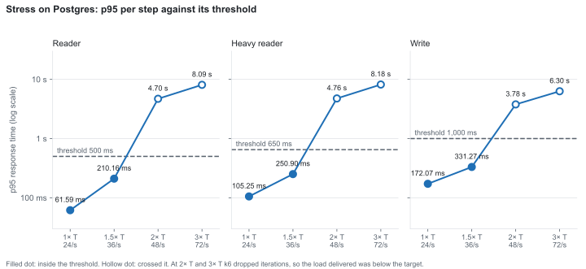
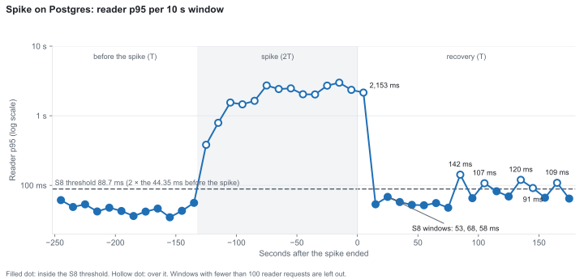
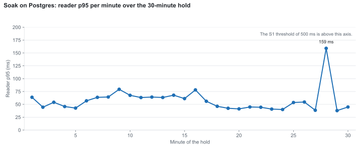

# Load Test Results: Strapi 5 with k6

I load tested a Strapi 5 REST API with k6 on one laptop, on SQLite and on Postgres. This document gives the numbers, the verdict on each of my thresholds S1 to S8, and the things I could not explain. The reasons for the thresholds are in the [strategy](01-load-test-strategy.md), the method is in the [plan](02-load-test-plan.md) and how the test setup is built is in the [test architecture](04-test-architecture.md). Raw output stays in `results/`, which is git-ignored.

## Summary

- **Target load.** A *journey* is a short run of requests; a reader or writer journey is 3 requests. On SQLite the breaking point C, the rate where reader p95 breaks 500 ms, was between 48 and 56 journeys per second. I set the target load T to 24 journeys per second, half of the lowest plausible breaking point, and reused it on Postgres. (*p95* is the response time that 95 out of 100 requests beat, *p99* the same for 99 out of 100.)
- **At T both databases kept inside S1 to S6** on every planned repeat. Reader p95 was 53.03 ms on SQLite (median of three repeats). On Postgres it was between 143.05 and 216.07 ms in the three planned repeats and between 47.2 and 61.59 ms in the other runs at T.
- **What gave out first on Postgres:** S6, the CPU threshold, at 1.5 times T (36 journeys per second). Strapi's CPU mean was 82.72% against my threshold of 80%. The latency thresholds S1, S2 and S3 broke together at 2 times T (48 journeys per second), where Strapi's Node process was using about 102% of one logical processor.
- **SQLite against Postgres at T:** Postgres p95 was 0.9× to 4.1× SQLite's for the reader, 1.5× to 4.6× for the heavy reader and 1.6× to 5.2× for the writer, depending on which Postgres run I compare. The three planned Postgres repeats were the slowest, and I could not explain why.
- **Failures:** S4 and S5 never broke in the load, stress, spike and soak runs: no failed request and no 429 response.
- **Spike:** reader p95 returned to within twice its pre-spike level within 60 s (S8 passed). Later windows went over that level again, and I could not explain it.
- **Soak:** Strapi's private memory grew 1.2% over 30 minutes against my threshold of 20% (S7 passed).

## Setup and limits of these results

| Item | Details |
|---|---|
| Machine | Windows laptop, 2 physical cores (4 logical processors), 7.88 GB usable RAM |
| Strapi | 5.59.0, production mode, run directly on Windows |
| Node, k6 | Node 24.21.0, k6 v2.3.0 |
| Databases | SQLite (Strapi's file database) and Postgres 17.11, native on Windows, default settings |
| Data | 2,000 Articles (1,700 published, 300 drafts), 20 Authors, 10 Categories, 6 cover images of about 1.2 MB |

- **One laptop.** k6, Strapi and the database share 4 logical processors and one pool of memory. Absolute numbers will not match a real server, so I trust only comparisons: SQLite against Postgres, one step against another.
- **Single runs.** Only the load runs were repeated. Stress, spike and soak ran once each, so they show behaviour, not a spread.
- **The machine moved.** In SQLite repeat 2 and Postgres repeat 3, about 1 GB of memory was taken by something else for a short time. I did not find out what.
- **Data grows during a run.** The writer adds published Articles, so the late part of a run uses a bigger database. I restored the snapshot before every run and counted Articles before and after.
- **Windows are approximate.** The sampler reads every 5 seconds, so CPU windows are accurate to about 10 seconds.

## How I ran it

| Run | Database | What | How often |
|---|---|---|---|
| Calibration | SQLite | Two ladders of 60 s steps, from 2 to 24 and from 24 to 80 journeys per second | once each |
| Baseline | SQLite | 6 journeys per second (T/4): a 60 s warm-up at 12, then a 5-minute hold | once |
| Load | SQLite | T = 24, 60 s warm-up at 12, 10-minute hold, login 5 per minute | 3 repeats |
| Load | Postgres | the same | 3 repeats, plus a fourth as a check |
| Stress | Postgres | 60 s warm-up, then 3-minute steps at 24, 36, 48 and 72 journeys per second (1×, 1.5×, 2× and 3× T) | once |
| Spike | Postgres | 60 s warm-up, 120 s at T, a jump to 2T in 10 s held for 120 s, then 180 s back at T | once |
| Soak | Postgres | 30-minute hold at T after a 60 s warm-up | once |

Before each run I restored the snapshot, started Strapi, ran the data check (the generator must report that it created nothing and that the counts are 2,000, 1,700 and 300), and checked the machine: Chrome and other apps closed, charger in, best-performance power mode, sleep off. A sampler recorded Strapi, k6 and Postgres CPU and memory every 5 seconds, and a watchdog stopped k6 if free memory fell below 800 MB. The warm-up is excluded from the thresholds by tagging it as its own phase.

S1 to S5 are k6 thresholds, so the run itself fails when one breaks. S6 to S8 are judged after the run by `scripts/judge-runs.js` from the sampler files and the raw points. Where the data cannot support a verdict, the script says "not evaluable" and gives the reason. It first reproduces the numbers I had already seen (CPU means, the S7 medians, the S8 reference and windows), and every one matched.

## Calibration, target load and baseline

- **Breaking point.** Reader p95 stayed between 32 and 50 ms at every step up to 24 journeys per second. In the second ladder it was 55, 60, 111 and 224 ms up to 48, then 1.39 s at 56, 2.31 s at 64 and 5.13 s at 80. So C is between 48 and 56 journeys per second. k6 ran out of virtual users from 56 on, and the database grew during the ladder, so I state C as a range.
- **Target load.** T = 24 journeys per second, half of the lowest plausible C, reused on Postgres.
- **Baseline.** At 6 journeys per second the hold gave reader / heavy / write p95 of 25.76 / 64.82 / 78.02 ms with no failures. I set S2 at 10 times the heavy p95, rounded up to the next 50 ms: 650 ms.

## Results at the target load

Hold p95 in milliseconds at T = 24 journeys per second. The hold is the steady part of a run after the warm-up.

| Run | Hold length | Reader | Heavy | Write | Articles at end of run |
|---|---|---|---|---|---|
| SQLite repeat 1 | 10 min | 53.91 | 58.84 | 79.52 | 3,514 |
| SQLite repeat 2 | 10 min | 53.03 | 50.89 | 79.86 | 3,513 |
| SQLite repeat 3 | 10 min | 52.95 | 56.09 | 76.47 | 3,514 |
| **SQLite median** | | **53.03** | **56.09** | **79.52** | |
| Postgres repeat 1 | 10 min | 154.77 | 190.11 | 331.69 | 3,514 |
| Postgres repeat 2 | 10 min | 143.05 | 204.52 | 327.70 | 3,513 |
| Postgres repeat 3 | 10 min | 216.07 | 256.26 | 414.46 | 3,512 |
| **Postgres median of repeats 1 to 3** | | **154.77** | **204.52** | **331.69** | |
| Postgres load run 4 (check) | 10 min | 61.13 | 101.16 | 150.26 | 3,514 |
| Postgres stress, step at 24/s | 3 min | 61.59 | 105.25 | 172.07 | 4,728 (whole run) |
| Postgres spike, pre phase | 2 min | 47.2 | 85.5 | 128.9 | 3,365 (whole run) |
| Postgres soak | 30 min | 55.06 | 98.52 | 145.98 | 6,394 |

The stress and spike values come from the early part of runs that later grow the database. The spike's pre-phase figures are computed from the raw points file; the others are k6's own.

**SQLite against Postgres, as a range.** Dividing each Postgres run by the SQLite median gives 0.9× to 4.1× for the reader, 1.5× to 4.6× for the heavy reader and 1.6× to 5.2× for the writer. The low ends come from the spike's pre phase and the soak, the high ends from Postgres repeat 3. The runs differ in length (2, 3, 10 and 30 minutes) and each Postgres figure is one run, so I do not give a single ratio.

Strapi's CPU mean in the hold (100% is one logical processor): SQLite 43.88% (repeats 43.36 to 45.06), Postgres 57.64% (repeats 57.01 to 58.24), Postgres run 4 55.31%, soak 53.95%.

## Verdicts for S1 to S8

| Threshold | SQLite | Postgres |
|---|---|---|
| S1 reader p95 under 500 ms | pass at T (3 of 3) | pass at T and at 1.5× T; broke at 2× T and in the spike |
| S2 heavy p95 under 650 ms | pass at T (3 of 3) | same |
| S3 write p95 under 1,000 ms | pass at T (3 of 3) | same |
| S4 fewer than 1% failed requests | pass in the load runs | pass in every run |
| S5 no 429 responses | pass in the load runs | pass in every run |
| S6 Strapi CPU mean under about 60% at T, about 80% at 1.5× T | pass at T (median 43.88%) | pass at T (median 57.64%); **fail at 1.5× T** (82.72%) |
| S7 Strapi private memory growth at most 20% in the soak | | pass (404 to 409 MB, +1.2%) |
| S8 reader p95 back within 2× of its pre-spike level within 60 s | | pass (windows +10 s to +40 s) |

Stress, spike and soak ran on Postgres only, so the empty cells are not results.

**Stress on Postgres.** Each step is its own tagged scenario. Dropped iterations are requests k6 wanted to start but could not.

| Step | Journeys per second | Reader p95 | Heavy p95 | Write p95 | Strapi CPU mean |
|---|---|---|---|---|---|
| 1× T | 24 | 61.59 ms | 105.25 ms | 172.07 ms | 59.14% |
| 1.5× T | 36 | 210.16 ms | 250.90 ms | 331.27 ms | 82.72% |
| 2× T | 48 | 4.70 s | 4.76 s | 3.78 s | 102.15% |
| 3× T | 72 | 8.09 s | 8.18 s | 6.30 s | 102.28% |

Reader, heavy and write p95 per step, from the table above, on a log axis. Filled dots are inside the threshold (500, 650 and 1,000 ms), hollow dots crossed it. At 2× T and 3× T k6 dropped iterations, so the load delivered was below the target.

S1, S2 and S3 broke together at 2× T, so the steps cannot say which came first. There were no failed requests and no 429 in any step. From 2× T, k6 ran out of virtual users: x2 dropped 1,206 reader, 22 heavy and 86 writer iterations, x3 dropped 4,943, 159 and 502 (6,919 in the run). The delivered load plateaued at about 40 journeys per second, so the 2× and 3× steps are not clean measurements of 48 and 72. Postgres CPU was 25 to 71% and k6 CPU 41 to 49% across the steps.

**Spike on Postgres.** Reader / heavy / write p95 was 47.2 / 85.5 / 128.9 ms before the spike, 2.49 / 2.63 / 2.10 s during it (all over their thresholds), and 93.5 / 159.0 / 239.3 ms in the recovery phase. The reference for S8 was the reader p95 over the 60 s before the spike: 44.35 ms, so the threshold was 88.7 ms. After the spike the first 10 s window was 2,153 ms (slow spike requests still finishing), then 53, 68 and 58 ms, which satisfies the rule. Five later windows went over the threshold: +80 s (142 ms), +100 s (107 ms), +130 s (120 ms), +140 s (91 ms) and +160 s (109 ms), so a stricter "stays under" reading would fail. All 12 windows before the spike were under the threshold (35 to 68 ms). The spike dropped 561 iterations, so k6 was the bottleneck in the spike phase.

Reader p95 per 10 s window, counted from the end of the spike. The axis marks the start of each window, so the three windows that satisfy S8 (53, 68 and 58 ms) start at +10, +20 and +30 s, the +10 s to +40 s span in the verdict table.

**Soak on Postgres.** Over the 30-minute hold, Strapi's private memory was 404 MB (median of the first 3 minutes) and 409 MB (last 3 minutes). Reader p95 per minute stayed between 38 and 79 ms, except one minute at 159 ms, while the database grew from 2,000 to 6,394 Articles. Table size and time since start grow together, so I cannot separate them.

Reader p95 per minute of the 30-minute hold. The S1 threshold of 500 ms is above the axis.

**Dropped iterations in the load runs:** none, except 19 in Postgres repeat 3; the soak dropped 1.

## What gave out first

On Postgres the first threshold to break was S6, at 1.5× T, while every latency threshold still held. At 2× T the Node main thread of Strapi was at about 102% of one logical processor, while Postgres was at about 70%. This fits my first risk, that a single Node process saturates one core and latency climbs from there. On SQLite the breaking point was between 48 and 56 journeys per second; on Postgres the breaking point was between 36 and 48.

## P99

The k6 summary files hold p90 and p95 only, so I report p99 for the spike and the soak, whose raw points I kept, and for no other run. There is no threshold on p99.

| Run, phase | Journey | Requests | p95 (ms) | p99 (ms) | Max (ms) |
|---|---|---|---|---|---|
| Spike, pre | reader | 6,915 | 47.2 | 92.3 | 264.3 |
| Spike, pre | heavy | 289 | 85.5 | 123.0 | 257.4 |
| Spike, pre | write | 576 | 128.9 | 229.1 | 339.4 |
| Spike, spike | reader | 13,167 | 2,488.8 | 2,868.5 | 3,209.1 |
| Spike, spike | heavy | 599 | 2,627.4 | 3,010.4 | 3,202.5 |
| Spike, spike | write | 1,142 | 2,100.6 | 2,411.5 | 2,631.5 |
| Spike, recovery | reader | 10,371 | 93.5 | 586.3 | 2,146.0 |
| Spike, recovery | heavy | 430 | 159.0 | 1,419.6 | 2,185.1 |
| Spike, recovery | write | 866 | 239.3 | 1,105.5 | 1,775.6 |
| Soak | reader | 103,683 | 55.1 | 123.8 | 1,060.3 |
| Soak | heavy | 4,320 | 98.5 | 162.0 | 1,020.6 |
| Soak | write | 8,642 | 146.0 | 271.5 | 1,041.9 |

## What I could not explain

- **The slow Postgres load repeats.** Repeats 1 to 3 gave reader p95 of 143 to 216 ms. Four later runs at the same rate (stress at 24/s, the spike's pre phase, the soak and load run 4) gave 47 to 62 ms. The three slow runs were the first three Postgres measured runs; every Postgres run after them was fast. This ordering is an observation, not an explanation; the cause is unexplained. What I checked: the load and soak profiles differ only in hold length and tag names; CPU speed, k6 CPU and memory, and k6's connection and transfer times were the same; the extra time was in the wait for the first byte, in the slowest 5 to 10% of requests. Table growth does not explain it, because the soak grew the table to three times its size and stayed fast.
- **The later S8 windows** over the threshold (+80 to +160 s). The 12 windows before the spike were all under it, so I do not think it is ordinary noise, but I do not know the cause.
- **Disturbances.** In SQLite repeat 2 and Postgres repeat 3 about 1 GB of memory was taken by something else for a short time, and Postgres repeat 3 had a Strapi CPU spike to 87%. I kept both runs.
- **Calibration incidents on SQLite.** One reset connection on a write in the first ladder (1 of 15,666 requests), and 459 refused connections in the 80 journeys per second step of the second (4.92% of that step's requests), with Strapi not restarted. Cause unknown.
- **One dropped iteration** in the soak, cause not checked.

## What I did not test

- The double-data run (about 4,000 Articles).
- Stress, spike and soak on SQLite.
- The upload scenario, GraphQL, the admin panel, and security.
- A monitoring stack such as Grafana, because everything ran on one laptop with little spare memory. The sampler files are my monitoring.
- Postgres tuning, a newer Strapi version, and load from more than one machine.
- The one fix (three runs before and three after a single change) is a possible next step. Postgres memory settings and the connection pool are the candidates, and I left them at their defaults.
